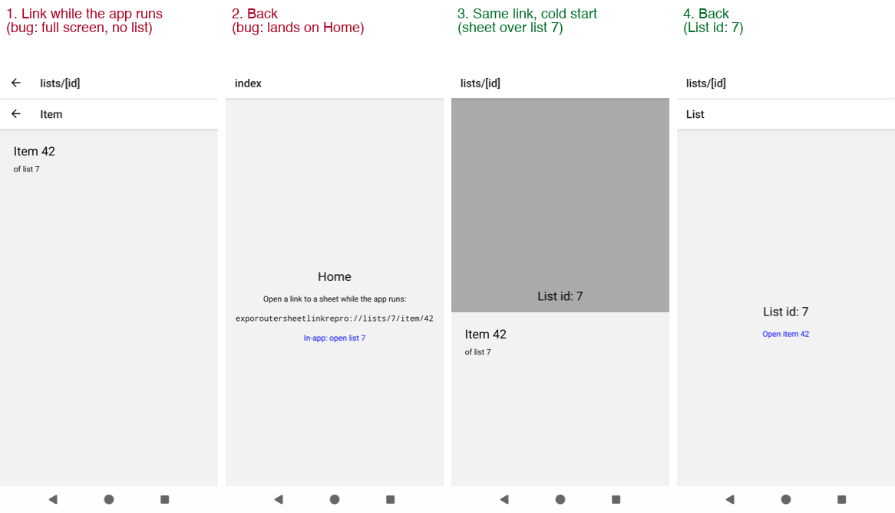
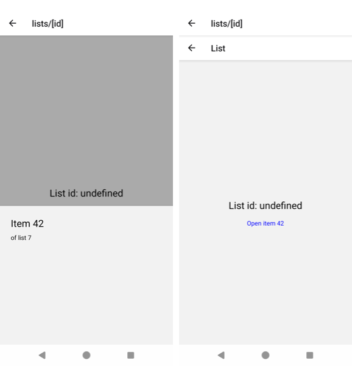

# expo-router: a link to a sheet that arrives while the app runs loses the anchor beneath it

Minimal reproduction for SDK 58 (`expo` 58.0.17, `expo-router` 58.0.25, `react-native` 0.88.0, `react-native-screens` 4.30.0, New Architecture).

## Routes

```
app/_layout.tsx                    Stack
app/index.tsx                      Home
app/lists/[id]/_layout.tsx         Stack, unstable_settings = { anchor: 'index' }
app/lists/[id]/index.tsx           the list page (shows its `id`)
app/lists/[id]/item/[itemId].tsx   presentation: 'formSheet'
```

A link to `/lists/7/item/42` should open the item sheet over list 7, and Back from the sheet should land on list 7.

## Steps (Android)

```sh
npm install
npx expo run:android --variant release
```

1. Start the app; it shows Home. Start from Home, not from the list page: if list 7 is already open, the sheet opens over it as expected. With the app running on Home, open the link:
   ```sh
   adb shell am start -a android.intent.action.VIEW -d "exporoutersheetlinkrepro://lists/7/item/42" dev.repro.exporoutersheetlink
   ```
2. Press Back.

For comparison, force-stop the app and open the same link from a cold start.

## Expected

In both cases the sheet opens over list 7 (the `anchor`), and Back shows "List id: 7". That is what happens on a cold start.

## Actual

Link while the app runs (from Home): the item opens as a full-screen page instead of a sheet, with nothing beneath it. Back lands on Home (screens 1 and 2).

The same link from a cold start works: the sheet opens over list 7, and Back shows "List id: 7" (screens 3 and 4).



## SDK 57

The same app on SDK 57 (`expo` 57.0.31, `expo-router` 57.0.29, `react-native` 0.86.3), release build, link while the app runs: the sheet does open over the list page, but the page gets no params ("List id: undefined"). So the missing anchor is new in SDK 58, the missing anchor params are older.



## Test

`npm test` (SDK 58) runs `__tests__/sheetLink.test.tsx` with `expo-router/testing-library`. It feeds the link through a `+native-intent` `legacy_subscribe` listener, the path the OS uses for a link while the app runs:

```
✓ cold start: opens the sheet over its anchor, which gets its params (works)
✕ app running: opens the sheet over its anchor, which gets its params (fails on SDK 58)
    Expected: "/lists/7"
    Received: "/"
```

## Cause

`build/fork/useLinking.native.js` turns a link that arrives while the app runs into a `NAVIGATE` without `withAnchor`, unlike the initial URL. So the nested stack is built without its anchor.

With `withAnchor: true` alone the list page comes back, but without its params (`id` is `undefined`): `createDestinationState` in `build/global-state/resolveNavigationDestination.js` creates the anchor route without the params of the layout it belongs to. A seeded state on a cold start does give it those params.

## Suggested fix

[`fix/expo-router.patch`](fix/expo-router.patch) does both:

1. `useLinking.native.js`: pass `withAnchor: true` for links while the app runs, like the initial URL.
2. `resolveNavigationDestination.js`: hand the target route's params down to the anchor route.

Apply it to check the test turns green:

```sh
(cd node_modules/expo-router && patch -p3 < ../../fix/expo-router.patch)
npm test
```
